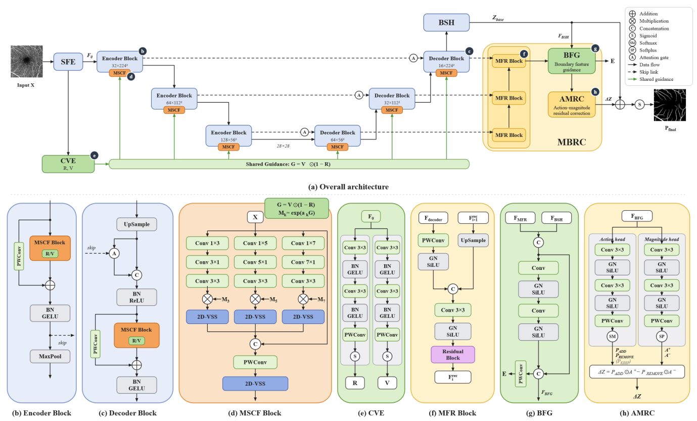
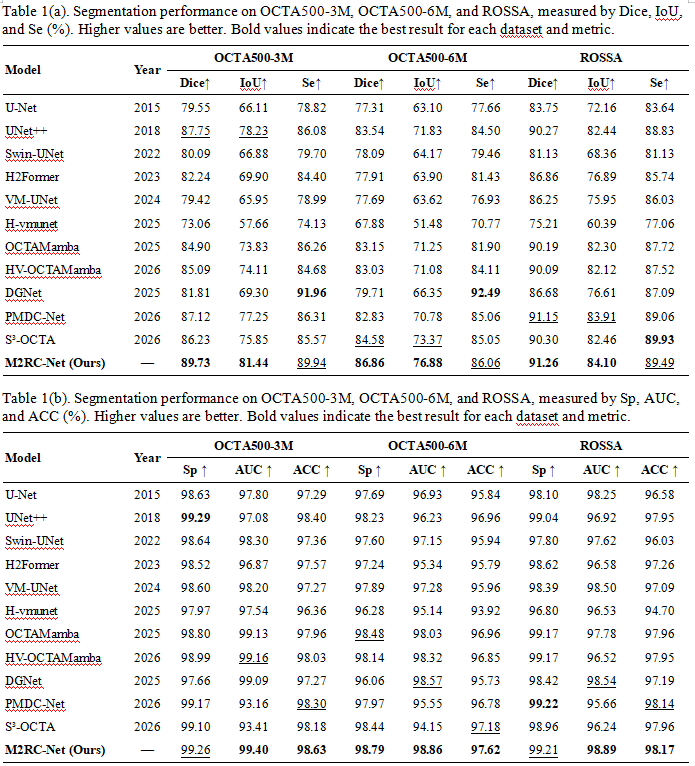
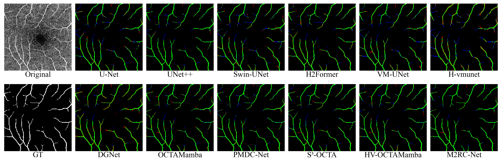
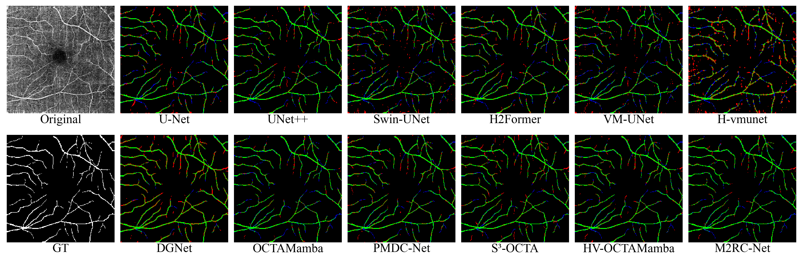
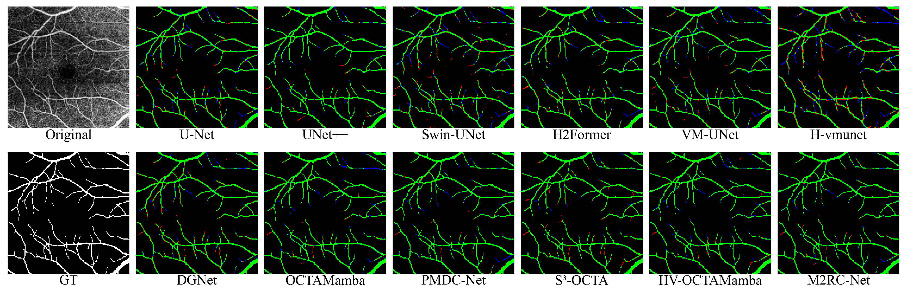

<div align="center">
  <h2>M2RC-Net</h2>
  <p><strong>M2RC-Net: Multi-Scale Context Fusion and Multistage Bidirectional Residual Correction for OCTA Retinal Vessel Segmentation</strong></p>
  <p><a href="README.md">English</a> | <a href="README_Zh.md">简体中文</a></p>
</div>

## Abstract

Retinal vessel segmentation in optical coherence tomography angiography (OCTA) is challenged by vessel-scale variation, low capillary contrast, and imaging artifacts. We propose **M2RC-Net**, a U-shaped visual state-space network that combines multiscale feature representation with prediction-level correction.

**Multi-Scale Context Fusion (MSCF)** integrates multiscale convolutional features and visual state-space modeling. **Multistage Bidirectional Residual Correction (MBRC)** uses multistage decoder features to predict additive and subtractive corrections to the base logits. An auxiliary **Caliber and Vesselness Estimation (CVE)** component provides structural guidance for the six MSCF stages.

M2RC-Net achieves Seed 0 Dice scores of **89.73%**, **86.86%**, and **91.26%** on OCTA500-3M, OCTA500-6M, and ROSSA, respectively. This repository provides the full model, five ablation configurations, pretrained weights, and unified training and testing entry points.

## Architecture



The backbone contains an embedding layer, three encoder stages, and three decoder stages connected by skip connections and attention gates. CVE supplies structural guidance. MBRC receives D3, D2, D1, and the base logits, then produces the final logits through Multistage Feature Recovery (MFR), Boundary Feature Guidance (BFG), and Action–Magnitude Residual Correction (AMRC).

## Quantitative Results

Seed 0 results on three datasets. Metrics are percentages; higher is better. Full M2RC-Net checkpoints are selected by validation Final Dice.



## Qualitative Visualization

Original images are grayscale and GT vessels are white. Error maps show true-positive vessels in green, false positives in red, false negatives in blue, and background in black.

**OCTA500-3M — 10497.bmp**



**OCTA500-6M — 10248.bmp**



**ROSSA — 211.png**



## Installation

The experiments use **Linux**, **Python 3.8.19**, **PyTorch 2.0.0**, **CUDA 11.8**, **torchvision 0.15.0**, **Triton 2.0.0**, **Mamba 1.0.1**, and **Causal-Conv1d 1.0.0** on an NVIDIA GeForce RTX 2080 Ti.

### 1. Create the environment

Run the following commands from the repository root:

```bash
conda create -n m2rcnet python=3.8.19
conda activate m2rcnet
conda install pytorch==2.0.0 torchvision==0.15.0 pytorch-cuda=11.8 -c pytorch -c nvidia
```

### 2. Install dependencies

Use the Conda PyTorch packages above and install the remaining dependencies:

```bash
python -m pip install numpy==1.24.4 opencv-python-headless==4.8.1.78 \
  timm==0.4.12 scipy==1.10.1 tqdm==4.66.5 PyYAML==6.0.3 \
  scikit-learn==1.3.2 einops==0.6.1 scikit-image==0.21.0

python -m pip install packaging==23.2 ninja==1.11.1.1 triton==2.0.0 \
  transformers==4.35.2 tokenizers==0.15.2 huggingface-hub==0.36.2 Pillow==10.0.1
```

### 3. Install Mamba and Causal-Conv1d

The following official wheels match **CPython 3.8 / Linux x86-64 / PyTorch 2.0 / CUDA 11.8 / C++ ABI FALSE**:

```bash
python -m pip install --no-deps \
  "https://github.com/Dao-AILab/causal-conv1d/releases/download/v1.0.0/causal_conv1d-1.0.0%2Bcu118torch2.0cxx11abiFALSE-cp38-cp38-linux_x86_64.whl" \
  "https://github.com/state-spaces/mamba/releases/download/v1.0.1/mamba_ssm-1.0.1%2Bcu118torch2.0cxx11abiFALSE-cp38-cp38-linux_x86_64.whl"

python -m pip check
```

For other binary tags or source installation, see [Installation and compatibility](docs/installation.md). Use the Conda setup above with these commands; `requirements.txt` records the corresponding pip package specifications.

### 4. Check the environment

```bash
python -c "import torch; from mamba_ssm.ops.selective_scan_interface import selective_scan_fn; print('PyTorch:', torch.__version__); print('CUDA:', torch.version.cuda); print('CUDA available:', torch.cuda.is_available())"
```

## Data Preparation

Obtain each dataset under its provider's terms:

- **OCTA-500:** [IEEE DataPort](https://ieee-dataport.org/open-access/octa-500). Use the two-dimensional en face projections and vessel annotations for OCTA500-3M and OCTA500-6M.
- **ROSSA:** the authors' [OCTA-FRNet repository](https://github.com/nhjydywd/OCTA-FRNet), including manual and SAM-assisted annotations.

Organize paired images and labels according to `splits/<dataset>/{train,val,test}.txt`. The loaders validate the fixed membership and seed-dependent ordering. Provider archives may require manual organization; do not generate a new split. Raw data and CVE caches are not included.

| Dataset alias | Directory name | Train | Validation | Test |
|---|---|---:|---:|---:|
| `3m` | `OCTA500_3M` | 140 | 10 | 50 |
| `6m` | `OCTA500_6M` | 180 | 20 | 100 |
| `rossa` | `ROSSA` | 718 | 100 | 100 |

```text
data/
  OCTA500_3M/
    train/{image,label}/
    val/{image,label}/
    test/{image,label}/
  OCTA500_6M/
    train/{image,label}/
    val/{image,label}/
    test/{image,label}/
  ROSSA/
    train_manual/{image,label}/   # 100 manually annotated images
    train_sam/{image,label}/      # 618 SAM-assisted images
    val/{image,label}/           # 100 manually annotated images
    test/{image,label}/          # 100 manually annotated images
```

Image/label filenames must match. Retain the final directory names `OCTA500_6M` and `ROSSA` under alternative parent paths. Images and labels are loaded in grayscale, resized to **224 × 224** with linear and nearest-neighbor interpolation respectively, and divided by 255. No additional training augmentation is used.

Generate CVE supervision on CPU into a new or empty directory:

```bash
python prepare_cve.py --dataset 3m \
  --data-root data/OCTA500_3M \
  --output-dir data/CVE_OCTA500_3M_maps --workers 4

python prepare_cve.py --dataset 6m \
  --data-root data/OCTA500_6M \
  --output-dir data/CVE_OCTA500_6M_maps --workers 4

python prepare_cve.py --dataset rossa \
  --data-root data/ROSSA \
  --output-dir data/CVE_ROSSA_maps --workers 4
```

Each dataset's normalization P99 uses valid training centerline widths only. Vesselness supervision is the segmentation GT. See [docs/cve_cache.md](docs/cve_cache.md) for the algorithm and cache format. Both training and evaluation of `mscf_cve` and `m2rcnet` require this cache.

## Training

Full model:

```bash
python train.py --model m2rcnet --dataset 3m --seed 0
python train.py --model m2rcnet --dataset 6m --seed 0
python train.py --model m2rcnet --dataset rossa --seed 0
```

Five ablation configurations:

```bash
python train.py --model base --dataset 3m --seed 0
python train.py --model mscf --dataset 3m --seed 0
python train.py --model mscf_cve --dataset 3m --seed 0
python train.py --model mbrc --dataset 3m --seed 0
python train.py --model m2rcnet_wo_cve --dataset 3m --seed 0
```

Change `--seed` to select a training seed. Specify alternative data and cache paths with `--data-root` and `--map-root`:

```bash
python train.py --model m2rcnet --dataset 3m --seed 3 \
  --data-root data/OCTA500_3M --map-root data/CVE_OCTA500_3M_maps
```

Training uses Adam, learning rate `1e-4`, weight decay `1e-3`, batch size 2, maximum 400 epochs, and early-stopping patience 40, without an LR scheduler. Checkpoints are saved when mean per-image validation Dice strictly improves, using the Final Head for MBRC configurations. Test results do not select checkpoints.

The entry point sets `CUBLAS_WORKSPACE_CONFIG=:4096:8` before importing PyTorch, seeds Python/NumPy/PyTorch/CUDA and the training DataLoader, disables cuDNN benchmarking, and enables deterministic algorithms. Use the same hardware and software configuration for reproducibility.

Default output structure:

```text
log/<dataset>/proposed/<configuration>/seed_<seed>/run_<NNN>/
```

Dataset directories are `OCTA500_3M`, `OCTA500_6M`, and `ROSSA`. Configuration directories are `base`, `base_mscf`, `base_mscf_cve`, `base_mbrc`, `M2RC-Net_wo_CVE`, and `M2RC-Net`.

Each run saves `console.log`, `metadata.json`, `history.jsonl`, `summary.json`, and the Val-best `model_best.pth`. Completion creates `finished.flag`; repeated runs receive new run numbers. `--result-dir` selects another output directory and protects existing training files.

## Testing

Specify a Val-best checkpoint matching the model, dataset, and seed:

```bash
python test.py --model m2rcnet --dataset 3m --seed 0 \
  --checkpoint checkpoints/m2rcnet_3m_seed0.pth

python test.py --model m2rcnet --dataset 6m --seed 0 \
  --checkpoint checkpoints/m2rcnet_6m_seed0.pth

python test.py --model m2rcnet --dataset rossa --seed 0 \
  --checkpoint checkpoints/m2rcnet_rossa_seed0.pth
```

Ablation tests use the same six model identifiers. `--config` and `--variant` remain supported; `--variant` is an alias for `--model`. Checkpoint loading is strict.

For the full model, JSON output contains `base_dice`, `final_dice`, and loss components. Dice values are fractions in `[0,1]`; multiply by 100 for percentages.

Evaluation applies sigmoid, per-image Min–Max normalization, uint8 conversion, and Otsu thresholding, then averages per-image Dice over the fixed test set. The full-model evaluator also computes auxiliary losses and requires the CVE cache; the network forward pass itself uses images only.

## Pretrained Weights

Full M2RC-Net Seed 0 Val-best checkpoints are included below.

| Dataset | Model | Seed | Best epoch | Test Dice (%) | Checkpoint filename | Size (MB) | Download |
|---|---|---:|---:|---:|---|---:|---|
| OCTA500-3M | Full M2RC-Net | 0 | 134 | 89.73 | `m2rcnet_3m_seed0.pth` | 13.573949 | [Download](checkpoints/m2rcnet_3m_seed0.pth) |
| OCTA500-6M | Full M2RC-Net | 0 | 115 | 86.86 | `m2rcnet_6m_seed0.pth` | 13.573949 | [Download](checkpoints/m2rcnet_6m_seed0.pth) |
| ROSSA | Full M2RC-Net | 0 | 217 | 91.26 | `m2rcnet_rossa_seed0.pth` | 13.573949 | [Download](checkpoints/m2rcnet_rossa_seed0.pth) |

Sizes use decimal MB. SHA256 checksums:

```text
9373afeaf48fb6b245075a2fb81661d70c2c4e1a4321661bbb9d5a72779497e2  m2rcnet_3m_seed0.pth
f97c17762d14e8312973737442ea60935b3a91a9f442618d7c4610ceb41466de  m2rcnet_6m_seed0.pth
9485e6e676470db3784d8c75d8fbab6a1b78caa663fd3963bb8aada1b6d71769  m2rcnet_rossa_seed0.pth
```

## Acknowledgments

This work was inspired by [OCTAMamba](https://github.com/zs1314/OCTAMamba). We sincerely thank the authors for their valuable contributions and for making their code publicly available.

## Reference

Citation information will be updated upon publication.

License: [Apache-2.0](LICENSE). Components in [models/backbone.py](models/backbone.py) are adapted from [OCTAMamba](https://github.com/zs1314/OCTAMamba/blob/main/our_model/OCTAMamba.py). Modifications include backbone organization, module integration, and deterministic selective-scan handling.
