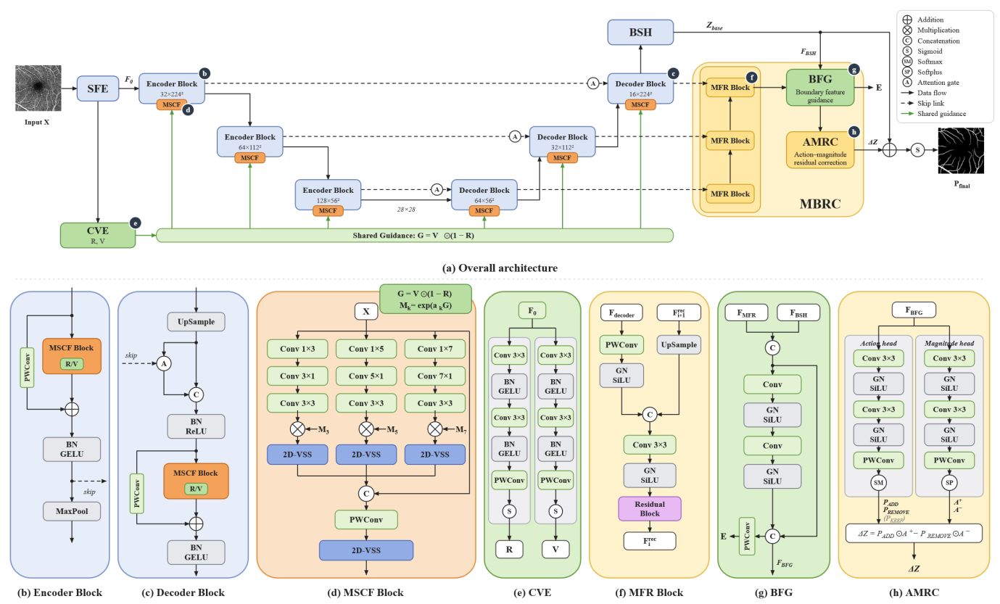
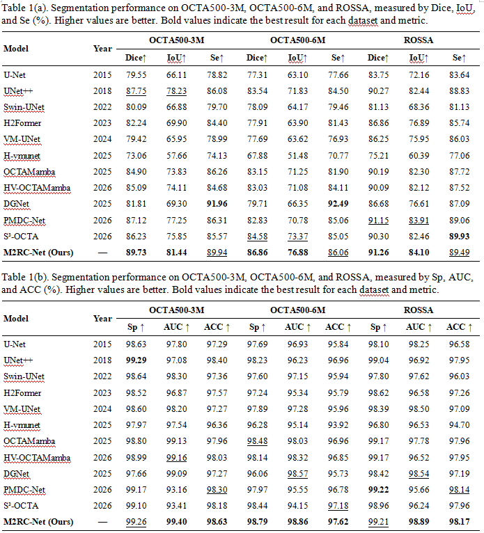
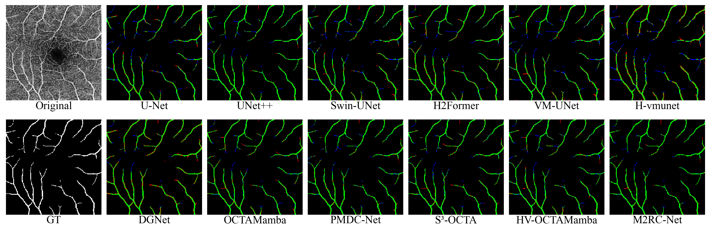
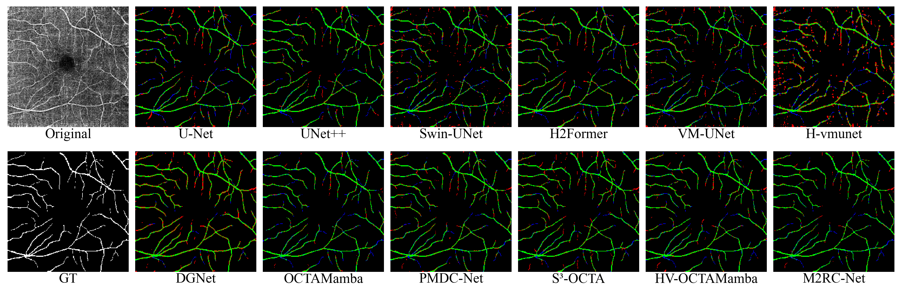
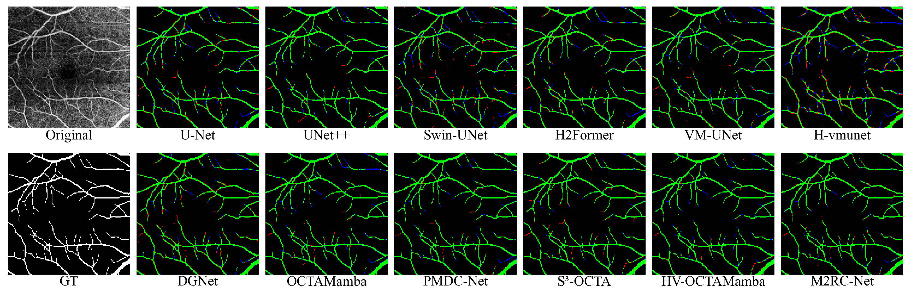

<div align="center">
  <h2>M2RC-Net</h2>
  <p><strong>M2RC-Net: Multi-Scale Context Fusion and Multistage Bidirectional Residual Correction for OCTA Retinal Vessel Segmentation</strong></p>
  <p><a href="README.md">English</a> | <a href="README_Zh.md">简体中文</a></p>
</div>

## 摘要

OCTA 视网膜血管分割面临血管尺度变化、毛细血管对比度低及成像伪影等挑战。我们提出 **M2RC-Net**，通过 U 形视觉状态空间网络，将多尺度特征表示与预测级校正相结合。

**多尺度上下文融合（MSCF）**整合多尺度卷积特征与视觉状态空间建模；**多阶段双向残差校正（MBRC）**利用多阶段解码特征，预测基础 logits 的增加和减去校正量。辅助组件**口径与血管性估计（CVE）**为六个 MSCF 阶段提供结构引导。

M2RC-Net 在 OCTA500-3M、OCTA500-6M 和 ROSSA 上的 Seed 0 Dice 分别为 **89.73%、86.86% 和 91.26%**。本仓库提供完整模型、五种消融配置、预训练权重，以及统一的训练和测试入口。

## 网络结构



主干包含嵌入层、三个编码阶段和三个解码阶段，通过跳跃连接和注意力门传递特征。CVE 提供结构引导。MBRC 接收 D3、D2、D1 和基础 logits，经多阶段特征恢复（MFR）、边界特征引导（BFG）和动作–幅值残差校正（AMRC）生成最终 logits。

## 定量结果

下图为三个数据集的 **Seed 0** 实验结果。指标以百分数表示，越高越好。完整模型根据验证集 Final Dice 选择 checkpoint。



## 定性可视化

Original 为灰度图，GT 血管为白色。误差图中，正确检出的血管为绿色，误检为红色，漏检为蓝色，背景为黑色。

**OCTA500-3M — 10497.bmp**



**OCTA500-6M — 10248.bmp**



**ROSSA — 211.png**



## 环境安装

实验环境为 **Linux、Python 3.8.19、PyTorch 2.0.0、CUDA 11.8、torchvision 0.15.0、Triton 2.0.0、Mamba 1.0.1 和 Causal-Conv1d 1.0.0**，GPU 为 NVIDIA GeForce RTX 2080 Ti。

### 1. 创建环境

在仓库根目录执行：

```bash
conda create -n m2rcnet python=3.8.19
conda activate m2rcnet
conda install pytorch==2.0.0 torchvision==0.15.0 pytorch-cuda=11.8 -c pytorch -c nvidia
```

### 2. 安装依赖

使用上述 Conda PyTorch 包，安装其余依赖：

```bash
python -m pip install numpy==1.24.4 opencv-python-headless==4.8.1.78 \
  timm==0.4.12 scipy==1.10.1 tqdm==4.66.5 PyYAML==6.0.3 \
  scikit-learn==1.3.2 einops==0.6.1 scikit-image==0.21.0

python -m pip install packaging==23.2 ninja==1.11.1.1 triton==2.0.0 \
  transformers==4.35.2 tokenizers==0.15.2 huggingface-hub==0.36.2 Pillow==10.0.1
```

### 3. 安装 Mamba 和 Causal-Conv1d

以下官方 wheel 对应 **CPython 3.8 / Linux x86-64 / PyTorch 2.0 / CUDA 11.8 / C++ ABI FALSE**：

```bash
python -m pip install --no-deps \
  "https://github.com/Dao-AILab/causal-conv1d/releases/download/v1.0.0/causal_conv1d-1.0.0%2Bcu118torch2.0cxx11abiFALSE-cp38-cp38-linux_x86_64.whl" \
  "https://github.com/state-spaces/mamba/releases/download/v1.0.1/mamba_ssm-1.0.1%2Bcu118torch2.0cxx11abiFALSE-cp38-cp38-linux_x86_64.whl"

python -m pip check
```

其他构建版本或源码安装方式见 [安装与兼容要求](docs/installation.md)。请将这些命令与上述 Conda 配置配套使用；`requirements.txt` 记录对应的 pip 包版本约束。

### 4. 检查环境

```bash
python -c "import torch; from mamba_ssm.ops.selective_scan_interface import selective_scan_fn; print('PyTorch:', torch.__version__); print('CUDA:', torch.version.cuda); print('CUDA available:', torch.cuda.is_available())"
```

## 数据准备

请遵守各数据提供方的获取和使用条款：

- **OCTA-500**：[IEEE DataPort](https://ieee-dataport.org/open-access/octa-500)。使用 OCTA500-3M、OCTA500-6M 的二维 en face 投影图和血管标注。
- **ROSSA**：作者的 [OCTA-FRNet 仓库](https://github.com/nhjydywd/OCTA-FRNet)，包含人工及 SAM 辅助标注。

按照 `splits/<dataset>/{train,val,test}.txt` 组织图像和标签。加载器会校验固定样本集合及对应 seed 下的顺序。原始压缩包可能需要手动整理，请勿重新划分数据。本仓库不包含原始数据和 CVE 缓存。

| 数据集参数 | 目录名称 | 训练集 | 验证集 | 测试集 |
|---|---|---:|---:|---:|
| `3m` | `OCTA500_3M` | 140 | 10 | 50 |
| `6m` | `OCTA500_6M` | 180 | 20 | 100 |
| `rossa` | `ROSSA` | 718 | 100 | 100 |

```text
data/
  OCTA500_3M/
    train/{image,label}/
    val/{image,label}/
    test/{image,label}/
  OCTA500_6M/
    train/{image,label}/
    val/{image,label}/
    test/{image,label}/
  ROSSA/
    train_manual/{image,label}/   # 100 manually annotated images
    train_sam/{image,label}/      # 618 SAM-assisted images
    val/{image,label}/           # 100 manually annotated images
    test/{image,label}/          # 100 manually annotated images
```

图像与标签必须完全同名。更换父目录时，保留末级目录名 `OCTA500_6M` 和 `ROSSA`。图像和标签以灰度读取，分别采用线性插值和最近邻插值缩放至 **224 × 224**，再除以 255；不额外使用训练数据增强。

在 CPU 上生成 CVE 监督，输出目录必须为空或尚未创建：

```bash
python prepare_cve.py --dataset 3m \
  --data-root data/OCTA500_3M \
  --output-dir data/CVE_OCTA500_3M_maps --workers 4

python prepare_cve.py --dataset 6m \
  --data-root data/OCTA500_6M \
  --output-dir data/CVE_OCTA500_6M_maps --workers 4

python prepare_cve.py --dataset rossa \
  --data-root data/ROSSA \
  --output-dir data/CVE_ROSSA_maps --workers 4
```

各数据集的归一化 P99 仅来自有效训练集中心线宽度。血管性监督直接使用分割 GT。算法及缓存格式见 [docs/cve_cache.md](docs/cve_cache.md)。`mscf_cve` 和 `m2rcnet` 的训练与评价均需要该缓存。

## 训练

完整版：

```bash
python train.py --model m2rcnet --dataset 3m --seed 0
python train.py --model m2rcnet --dataset 6m --seed 0
python train.py --model m2rcnet --dataset rossa --seed 0
```

五种消融配置：

```bash
python train.py --model base --dataset 3m --seed 0
python train.py --model mscf --dataset 3m --seed 0
python train.py --model mscf_cve --dataset 3m --seed 0
python train.py --model mbrc --dataset 3m --seed 0
python train.py --model m2rcnet_wo_cve --dataset 3m --seed 0
```

通过 `--seed` 更换随机种子，通过 `--data-root` 和 `--map-root` 指定其他数据及缓存路径：

```bash
python train.py --model m2rcnet --dataset 3m --seed 3 \
  --data-root data/OCTA500_3M --map-root data/CVE_OCTA500_3M_maps
```

训练使用 Adam、学习率 `1e-4`、权重衰减 `1e-3`、batch size 2、最大 400 epoch 和早停耐心值 40，无学习率调度器。逐图验证 Dice 均值严格提高时保存权重，包含 MBRC 时以 Final Head 为准；测试结果不参与权重选择。

入口在导入 PyTorch 前设置 `CUBLAS_WORKSPACE_CONFIG=:4096:8`，固定 Python、NumPy、PyTorch、CUDA 和训练 DataLoader 的随机性，关闭 cuDNN benchmark 并启用确定性算法。复现时应保持硬件和软件配置一致。

默认输出结构：

```text
log/<dataset>/proposed/<configuration>/seed_<seed>/run_<NNN>/
```

数据集目录为 `OCTA500_3M`、`OCTA500_6M` 和 `ROSSA`。配置目录为 `base`、`base_mscf`、`base_mscf_cve`、`base_mbrc`、`M2RC-Net_wo_CVE` 和 `M2RC-Net`。

每次运行保存 `console.log`、`metadata.json`、`history.jsonl`、`summary.json` 和验证集最佳权重 `model_best.pth`。完成后生成 `finished.flag`，重复运行分配新 run 编号。`--result-dir` 可指定其他输出目录，并保护已有训练文件。

## 测试

指定与模型、数据集和 seed 对应的验证集最佳权重：

```bash
python test.py --model m2rcnet --dataset 3m --seed 0 \
  --checkpoint checkpoints/m2rcnet_3m_seed0.pth

python test.py --model m2rcnet --dataset 6m --seed 0 \
  --checkpoint checkpoints/m2rcnet_6m_seed0.pth

python test.py --model m2rcnet --dataset rossa --seed 0 \
  --checkpoint checkpoints/m2rcnet_rossa_seed0.pth
```

消融测试使用相同六种模型标识。保留 `--config` 和 `--variant` 接口，`--variant` 为 `--model` 的别名。权重采用严格加载。

完整版 JSON 输出包含 `base_dice`、`final_dice` 和损失分量。Dice 为 `[0,1]` 小数，乘以 100 后为百分数。

评价流程为 Sigmoid → 逐图 Min–Max 归一化 → uint8 → Otsu 阈值分割，再对固定测试集的逐图 Dice 取平均。完整版评价程序同时计算辅助损失，需要 CVE 缓存；网络前向本身仅输入图像。

## 预训练权重

以下为仓库内提供的完整版 M2RC-Net Seed 0 验证集最佳权重。

| 数据集 | 模型 | Seed | 最佳 epoch | Test Dice (%) | 权重文件名 | 大小 (MB) | 下载 |
|---|---|---:|---:|---:|---|---:|---|
| OCTA500-3M | Full M2RC-Net | 0 | 134 | 89.73 | `m2rcnet_3m_seed0.pth` | 13.573949 | [Download](checkpoints/m2rcnet_3m_seed0.pth) |
| OCTA500-6M | Full M2RC-Net | 0 | 115 | 86.86 | `m2rcnet_6m_seed0.pth` | 13.573949 | [Download](checkpoints/m2rcnet_6m_seed0.pth) |
| ROSSA | Full M2RC-Net | 0 | 217 | 91.26 | `m2rcnet_rossa_seed0.pth` | 13.573949 | [Download](checkpoints/m2rcnet_rossa_seed0.pth) |

大小使用十进制 MB。SHA256 校验值：

```text
9373afeaf48fb6b245075a2fb81661d70c2c4e1a4321661bbb9d5a72779497e2  m2rcnet_3m_seed0.pth
f97c17762d14e8312973737442ea60935b3a91a9f442618d7c4610ceb41466de  m2rcnet_6m_seed0.pth
9485e6e676470db3784d8c75d8fbab6a1b78caa663fd3963bb8aada1b6d71769  m2rcnet_rossa_seed0.pth
```

## 致谢

本研究受到 [OCTAMamba](https://github.com/zs1314/OCTAMamba) 的启发。感谢作者的研究贡献以及公开提供的代码。

## 引用

论文正式发表后将更新引用信息。

本项目采用 [Apache-2.0](LICENSE) 许可证。[models/backbone.py](models/backbone.py) 中的部分组件改编自 [OCTAMamba](https://github.com/zs1314/OCTAMamba/blob/main/our_model/OCTAMamba.py)，修改涉及主干组织、模块集成与确定性 Selective Scan 处理。
